# Manual Técnico - Proyecto3
**Luciano Isaac Xiquín Ajpop - 201800632**
## Pruebas
### Fase 2
#### Con 2 replicas
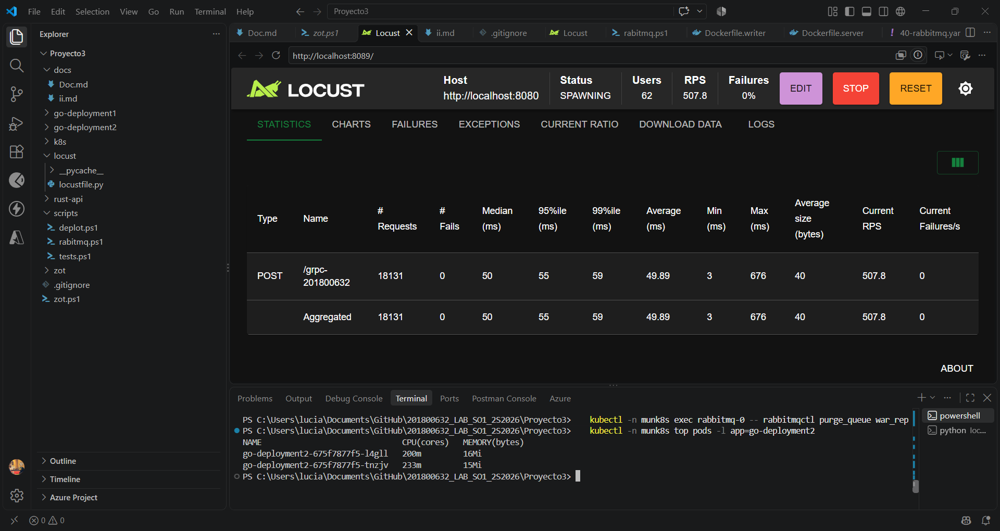
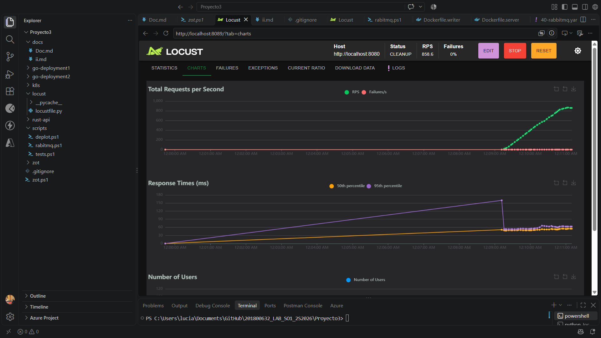
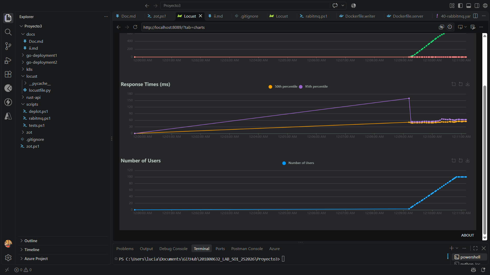
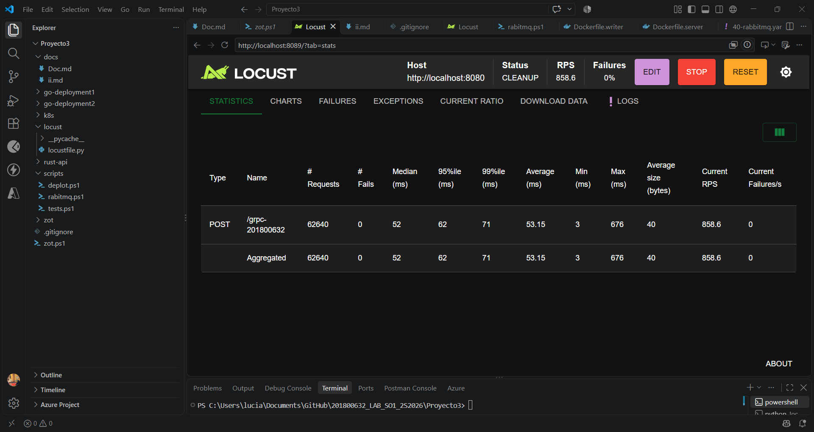
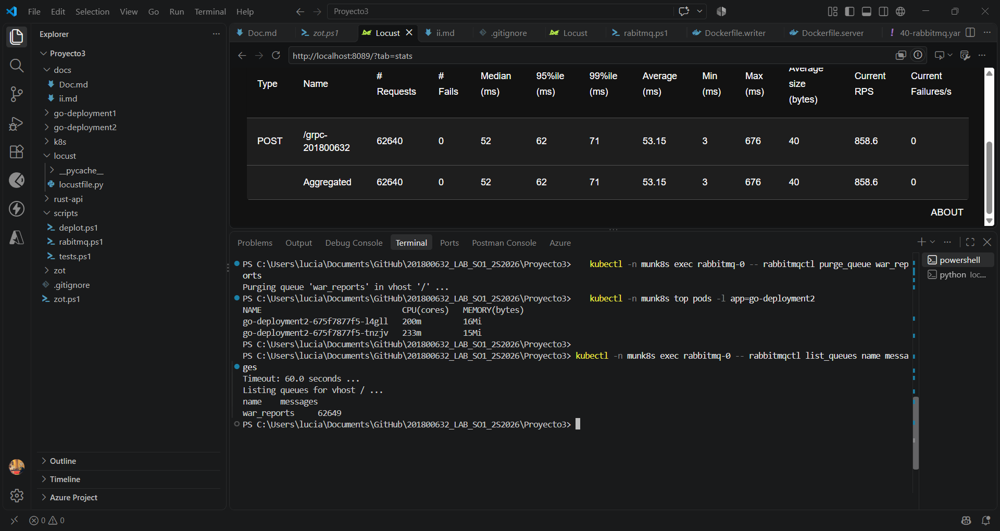
----
#### Con una replica
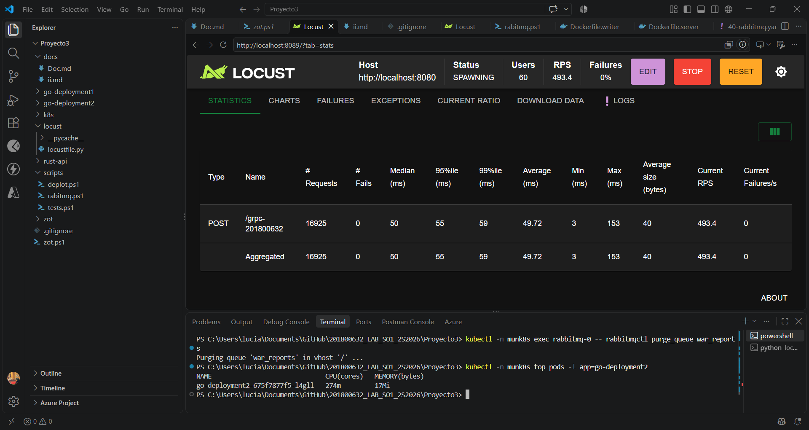
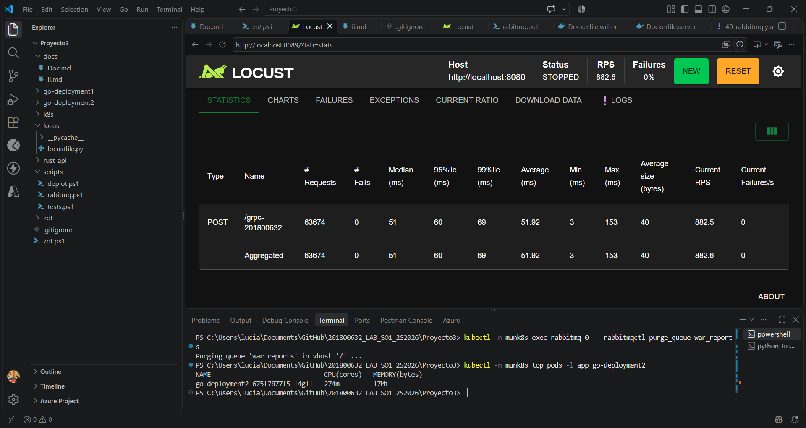
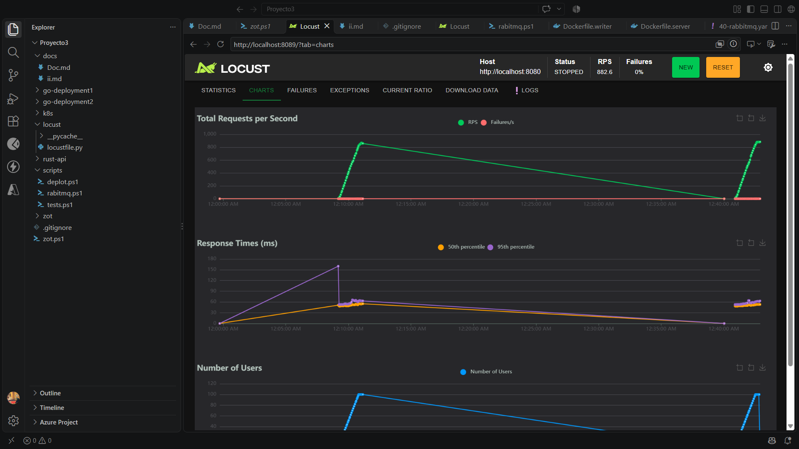
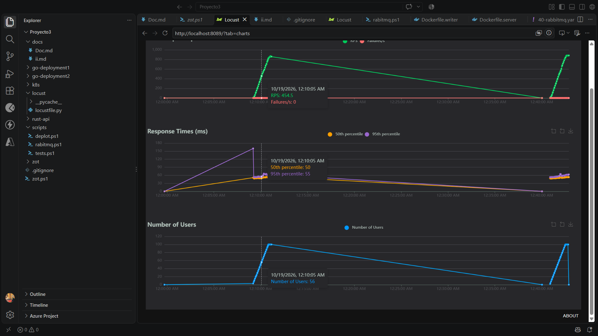
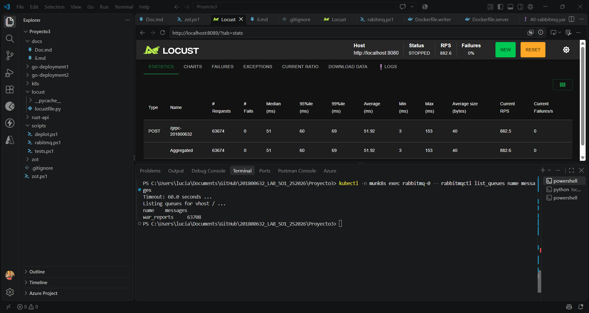
----
### Fase 3  
#### Configuración de Valkey y el Operator
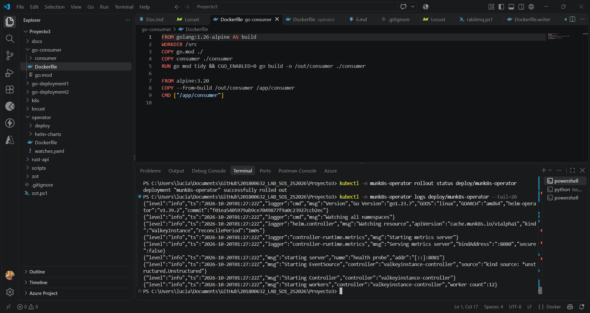
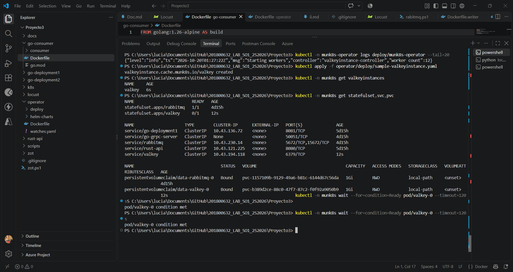
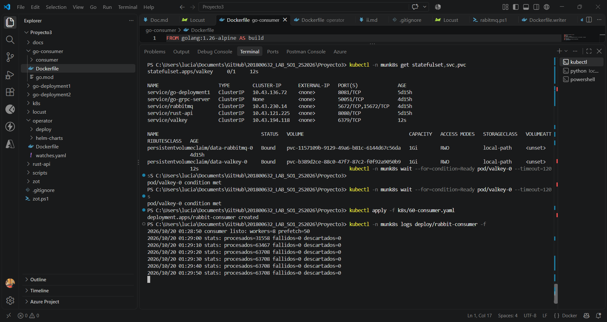
#### Datos de Valkey
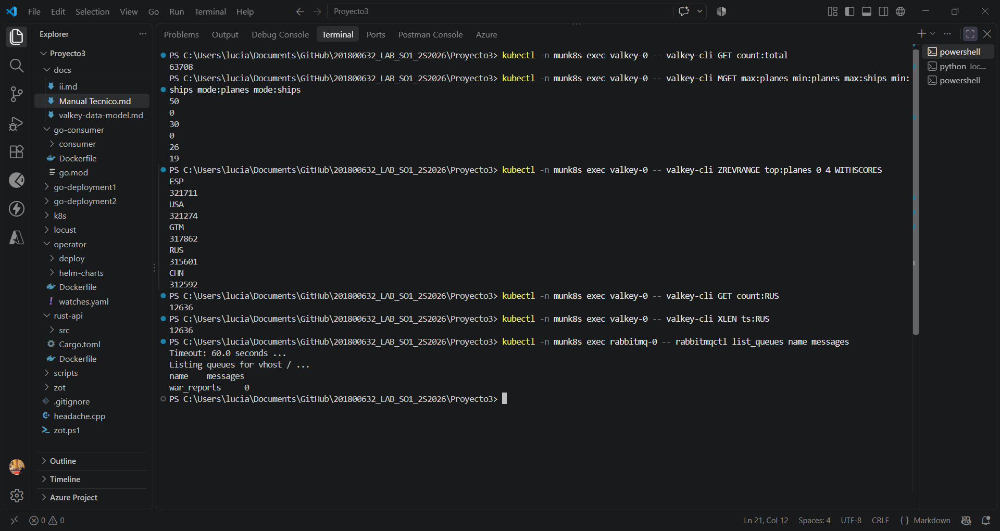
* Contadores
* Máximos y mínimos
* Top de países
* Moda
* Serie temporal
* Cola vacía (Consumer encendido)

#### Persistencia
Luego de borrar el pod de Valkey los datos se mantuvieron
```powershell
PS C:\Users\lucia\Documents\GitHub\201800632_LAB_SO1_2S2026\Proyecto3> kubectl -n munk8s exec valkey-0 -- valkey-cli GET count:total 
63708
PS C:\Users\lucia\Documents\GitHub\201800632_LAB_SO1_2S2026\Proyecto3> kubectl -n munk8s get pvc 
NAME              STATUS   VOLUME                                     CAPACITY   ACCESS MODES   STORAGECLASS   VOLUMEATTRIBUTESCLASS   AGE
data-rabbitmq-0   Bound    pvc-1157109b-9129-49a6-b81c-6144d67c56da   1Gi        RWO            local-path     <unset>                 4d20h
data-valkey-0     Bound    pvc-b389d2ce-88c0-47f7-87c2-f0f92a9050b9   1Gi        RWO            local-path     <unset>                 4h24m
PS C:\Users\lucia\Documents\GitHub\201800632_LAB_SO1_2S2026\Proyecto3> kubectl -n munk8s delete pod valkey-0
pod "valkey-0" deleted from munk8s namespace
PS C:\Users\lucia\Documents\GitHub\201800632_LAB_SO1_2S2026\Proyecto3> kubectl -n munk8s wait --for=condition=Ready pod/valkey-0 --timeout=120s
pod/valkey-0 condition met
PS C:\Users\lucia\Documents\GitHub\201800632_LAB_SO1_2S2026\Proyecto3> kubectl -n munk8s exec valkey-0 -- valkey-cli GET count:total
63708
PS C:\Users\lucia\Documents\GitHub\201800632_LAB_SO1_2S2026\Proyecto3>
``` 

#### Reconciliación del Operator
Un Operator no solo crea recursos: mantiene el estado deseado.
* A
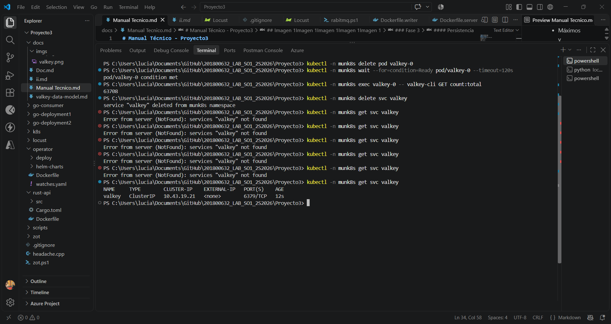
El Operator detecta que falta un recurso de su release y lo recrea. Debe reaparecer en segundos o, a lo sumo, en el siguiente ciclo de reconciliación (alrededor de un minuto; no lo pude medir). Captura el -w mostrando la desaparición y la reaparición, y el log del Operator.

* B
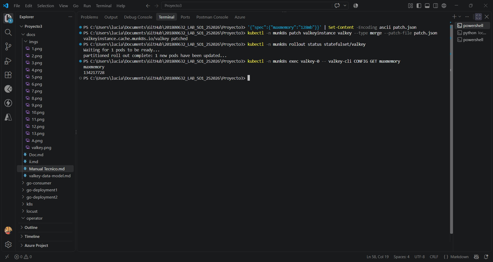
Un cambio en el Custom Resource se propaga

* C
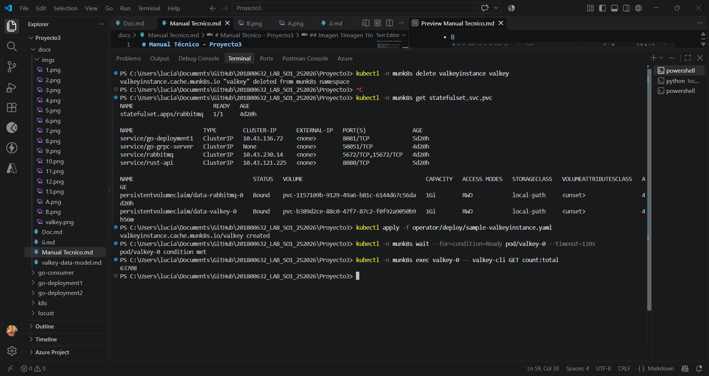
Desaparecen el StatefulSet y el Service, porque el Operator desinstala la release. El PVC se queda. Después se restaura.
El valor es el mismo que antes de borrar. Los datos persisten.

### Fase 4
#### Reconciliacion del Custom Resource
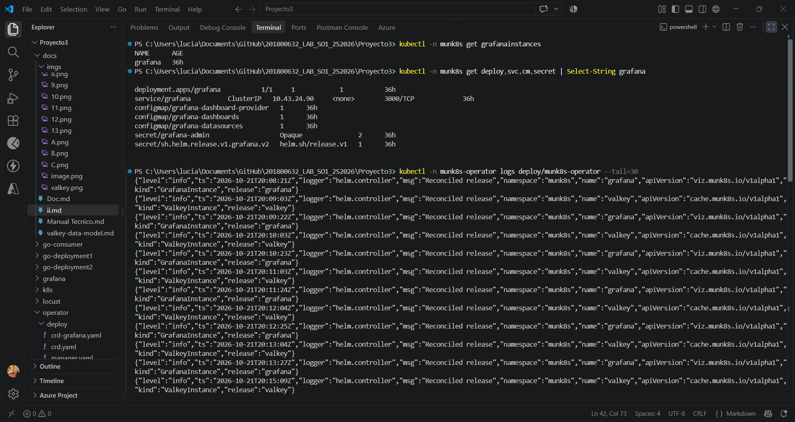
#### Valkey se conecta a Grafana
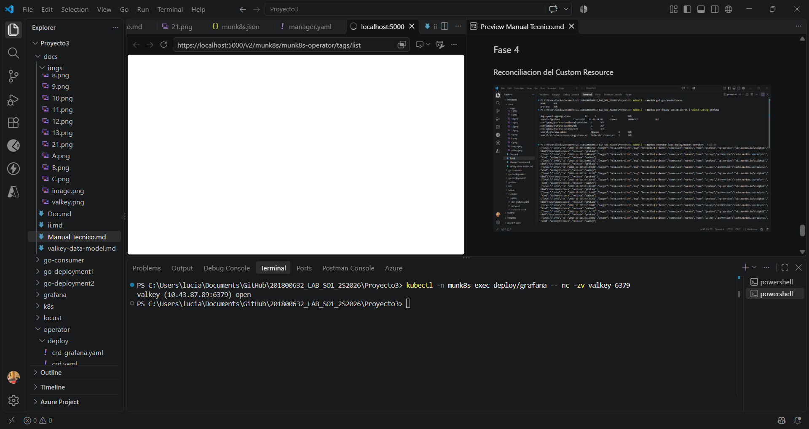